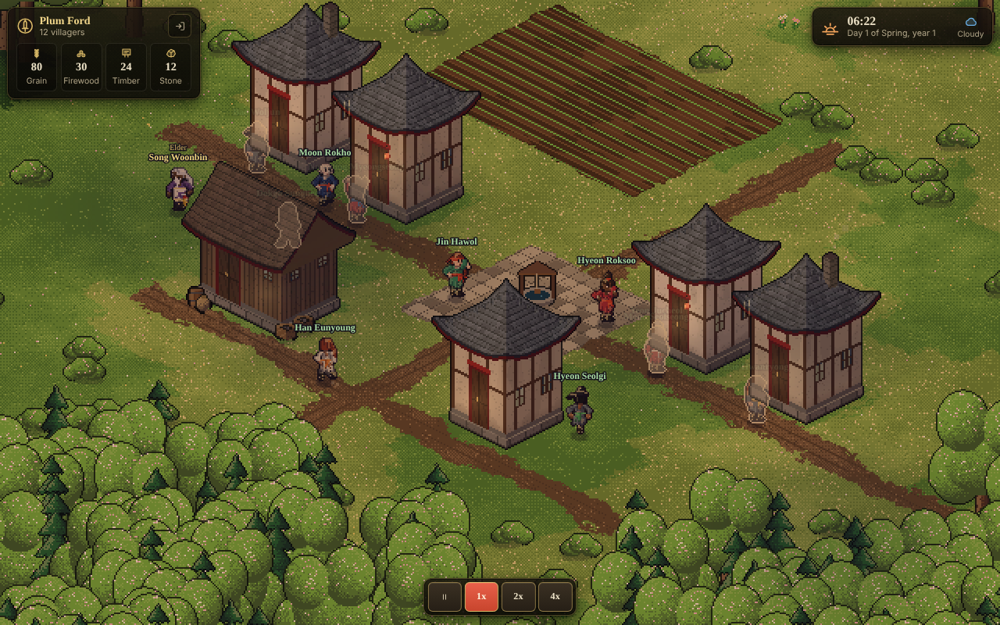
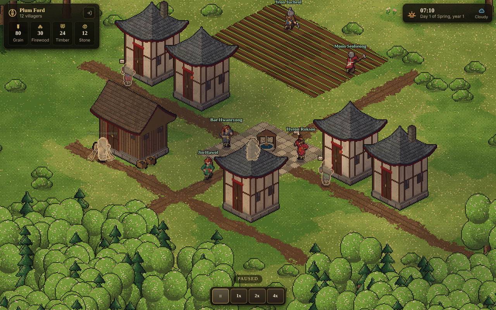

# M0: skeleton (copy and wire)

Milestone M0 of `docs/ROADMAP.md`, built on the branch `m0-skeleton`. Done when: you log in, see the village, pause and
change speed, and the server survives a restart with the village intact. All of that works end to end and is tested.

Source of the copies: `https://github.com/raymondsambur/murim-apocalypse-web.git`, branch `main` (cloned to a temporary
folder outside this repository; its `docs/ARCHITECTURE.md` and `docs/notes/*.md` were read first).

## What you get

- **`packages/shared`**: rng, noise, pathfinding, world grid, terrain and object codes, isometric constants, the M0
  protocol (`protocol.ts`), constants (calendar, speeds, steps), person and village names, and `worldgen.ts`: a
  deterministic 96 x 96 village map from a seed (grass, plains, forest with a thick treeline, a meandering stream with a
  bridge, four stone outcrops, Blight creeping in from the edges and strongest in the north-west) around a
  hand-placed starting village (five houses, a storehouse, a ploughed field, a well on a paved plaza, dirt streets).
- **`packages/sim`**: the library contract from `docs/ARCHITECTURE.md`: `createSim({ seed, saved })`, `command`,
  `step(dtGameMs)`, `view`, `events`, `serialize` (versioned, with a migration table ready), plus a `speed` getter. Pure and
  deterministic: one seeded rng whose state is saved, no wall clock, no `Math.random` (a test makes both throw), no I/O.
  Holds the calendar (24 h days, 30-day seasons, 120-day years; a game day is 6 real minutes at 1x), the weather (the old
  season-aware chain, one climate), the starting buildings and plots, and twelve placeholder villagers that walk the
  real pathfinding between the well, the plaza, the field, the storehouse and each other's doors by day and sleep at
  home from 21:00 to 05:30. `step` carries the remainder of a slice, so any chunking of game time gives identical results.
- **`packages/server`**: Fastify and `ws`; accounts (scrypt, HttpOnly cookie); SQLite (`users`, `sessions`, `villages`
  with a snapshot column and a `slot` so several saves fit later, `kv`); the village host with the tick loop; the
  websocket gateway with a rate limit, strikes, zod validation of every client message, one connection per account.
- **`packages/client`**: the isometric renderer and procedural art; login and register screen; the village screen with a
  village card (name, population, stockpile summary), a clock (time, date, season, weather) and time controls
  (pause, 1x, 2x, 4x; Space, 1, 2 and 3 on the keyboard); connection banner and take-over, sign-out and out-of-date cards;
  `?mock=1` runs the real sim in the page with a fake server.
- **CI, deploy files, bench**: see the sections below.

Screenshots of the production build in Chromium (`npm run build && npm start`, a new account, 1280 x 800).

## Protocol (M0)

HTTP: `POST /api/register`, `POST /api/login`, `POST /api/logout`, `GET /api/me`, `GET /api/world` (the account's map: terrain,
objects and Blight as base64), `GET /api/health`. The village is created on the account's first use (register or login).

WebSocket `/ws`, authenticated by the session cookie during the upgrade:

| direction | message |
|---|---|
| client to server | `{t:'hello', v}` (first, protocol version), `{t:'speed', speed: 0, 1, 2 or 4}` (0 pauses), `{t:'ping', n}` |
| server to client | `welcome`, then one full `view` (time, speed, entities, buildings, plots, stockpile summary, population), then `upd` five times a second: time, speed, population and the state of every entity; `add` and `del` when people arrive or leave; buildings, plots and stock only when they changed |
| server to client | `note`, `err`, `pong` |

Every client message is validated with zod (`packages/server/src/net/schemas.ts`); a compile-time check keeps the schema and
`C2S` in step. Entity `step` and `route` are in game milliseconds and tiles: the client runs people on a clock that moves
at the time-control speed (frozen when paused), so nothing is converted to real time. `route` is the server's lookahead of
up to six tiles, so people keep walking smoothly at 2x and 4x, where several steps fall between two updates.

## Time, speed and persistence

- The server steps the sim in constant slices of 100 game ms. Speed only changes how many slices run per 100 ms tick (0, 1, 2
  or 4); a stalled loop drops the lost time instead of bursting.
- The speed is part of the sim state (so it is saved). A village is simulated only while its owner is connected.
- A full versioned snapshot is written every `AUTOSAVE_MS` (30 s) while a village runs, and on pause, disconnect, replacement
  by a second login and shutdown. On the next connect the snapshot is loaded; a broken or unreadable snapshot is kept in
  `kv` as `village.<id>.broken.<time>` and the village starts over instead of locking the player out.
- `AWAY_CAP_HOURS` (default 8) is read, validated and **ignored**: a clearly marked config stub for the away policy of M4.
- The village seed is derived from `WORLD_SEED` and the account id and stored with the village, so changing `WORLD_SEED`
  later never moves an existing village.

## Copied, adapted, left out

In every file below `@murim/shared` became `@hearth/shared`.

### Copied unchanged

- `shared`: `rng.ts`, `noise.ts`, `pathfinding.ts`.
- `client/art`: `anim`, `arch`, `bctx`, `beasts`, `buildings`, `canvas`, `charbody`, `charctx`, `charhead`, `color`, `draw`,
  `figure`, `flora`, `gear`, `landmarks` (the shrine, hall, tower and gate building shapes), `mesh`, `mountain`, `nodes`, `noise`,
  `pixel`, `png`, `props`, `scale`, `scaleRef`, `sectprops`, `terrain`, `trinkets`, `walls`, `weapons` and the tests
  `art`, `gear`, `scale` and `sectprops`.
- `client/render`: `camera`, `chunks`, `index`, `input`, `iso`, `lighting`, `lru`, `occlusion` (and its test), `particles`, `weather`.
- `client/ui`: `dom`, `forms`, `screens/auth`, `screens/inkBackdrop`, `screens/screen`, `widgets/modal`, `widgets/tabs`,
  `widgets/toast`; `client/styles/screens.css`.
- `server`: `main.ts`, `log.ts` (was `game/log.ts`), `net/ip`, `net/ratelimit` and their tests, `net/gateway.test.ts`.

### Copied and adapted

- `shared/terrain.ts`: the terrain and object codes and the building kinds stay; settlements, work sites, spawn points,
  resource nodes and roads of the old world are gone; `WorldData` now carries a Blight grid and the starting village.
  `shared/worldgrid.ts`: the settlement lookup is gone. `shared/types.ts` (was the character, stats and mission types):
  only what the art needs is left (`Look`, `Dir`, `NpcRole`, `NpcAct`, weapon and gear looks, weather kinds, actor states).
  `shared/constants.ts`: new values (village size, calendar, game day, steps and speeds). `shared/data/names.ts`: person
  and village names only.
- `shared/worldgen.ts`: **new code**, built on the old generator's ideas (fbm height and moisture, object scatter, stream carving) but
  not copying its continent-scale parts (settlement siting, road network, spawn points, nodes, ruins).
- `client/art/character.ts` (state type), `client/art/palette.ts` (a banner colour is a plain CSS colour now; there are no
  factions yet).
- `client/render`: `api.ts` (the renderer takes `RenderEntity` values; no self entity, combat, settlements or minimap),
  `world.ts` (buildings from the sim, no settlements), `view.ts` (no follow camera, no fx or beacons, a sim clock for people),
  `scene.ts` (no settlement tints, banners or burning), `entities.ts`, `interp.ts` (route chaining), `clock.ts` (one weather, a
  `SimClock`), `life.ts`, `overlay.ts` (no rank colours), `sprites.ts` (one climate) and their tests.
- `client/ui`: `app.ts` (auth, then the game: no character creation), `settings.ts`, `format.ts`, `validation.ts`, `icons.ts`
  (new `pause` and `logs` icons), `hud/clock.ts`, `widgets/tooltip.ts` (generic tooltips only), `screens/game.ts`, `context.ts`,
  `i18n` (a new English dictionary), `styles/tokens.css`, `styles/components.css` (toast position), `styles/hud.css` (new HUD).
- `client/net`: `api.ts`, `base64.ts`, `socket.ts` (hello handshake, no queries), `mock.ts` (now runs the real sim) and their tests;
  `state/store.ts`, `state/session.ts` (rewritten small).
- `server`: `config.ts`, `auth.ts` (no character names), `db.ts` (new schema, same migration style), `http.ts` (no character
  routes; the map is per account), `net/gateway.ts` (the host instead of the old game object), `net/schemas.ts`, `server.ts`,
  and the tests of all of these.
- Deploy: `scripts/deploy.ps1`, `deploy/remote-deploy.sh` (same stop, backup, swap, health check and rollback; the first deploy on a
  machine is handled; paths can be overridden for testing), `deploy/backup.mjs`, the service, backup service and backup timer.

### Left out, and why

| left out | why |
|---|---|
| `server`: `game/*` (runtime, entities, players, area-of-interest, movement, chat, character creation, persistence, ambient crowd), `ctx.ts`, `testkit.ts`, `systems/*` (combat, monsters, missions, jobs, items, shops, social), `sim/*` (the continent sim: settlements, factions, economy, Blight), `siege/*` | MMO runtime and rules. The village host and the new `sim` replace them. The economy, Blight and weather ideas are mined later (M3). |
| `server`: `npclife/*`, `npcmemory/*` | Needed for M1 (agents with memory and rumours); adapted then, not copied now. |
| `shared`: `character`, `stats`, `ranks`, `progression`, `combat`, `crowd`, `guardplan`, `landmarks`, `townlayout`, `simtypes`, `data/{skills,items,jobs,monsters,origins,factions,dialogue}`, the old `protocol` and `worldgen` | Character and combat model, continent layouts and the MMO protocol. Items and jobs return, trimmed, in M3. |
| `client/art`: `itemicons`, `itemkit`, `itemmisc`, `imported`, `spriteimport` (and their tests, `assets/sprites`) | They draw items and import sprite packs, and need the old item and skill tables. Goods icons come with the economy (M3). |
| `client/render`: `fx`, `beacons`, `minimap` | Floating combat text and effects, landmark beacons of the old map, and a minimap of the old world. |
| `client/ui`: `panels/*`, `hud/*` except the clock, `logic/*`, `text/*`, `screens/create`, `standin`, `renderLoader`, `portrait`, `glyphMap`, `errors`, item widgets, `net/mock*` game data, `state/chatCommands`, `state/dispatch` | Chat, combat, missions, skills, sects, shops, inventory, character creation and the placeholder renderer. The management UI is new work (M1 onwards). |
| `client`: `sandbox.ts`, `assetGallery.ts`, `siegedemo.ts`, `uislots.ts` and their html pages | Dev pages tied to the old art pipeline and the siege. A village sandbox page was optional for M0 and is not built (the mock server covers UI work). |
| `scripts/`: art tools, `balance`, `crowd-bench`, `npc-talk-demo`, `preview-world`, `siege-bot`, `sim-soak` | MMO tooling. `scripts/bench.ts` is new; a soak script comes with M1. |
| `Dockerfile`, `.dockerignore` | The old game also ships as a container; this one runs as a systemd service. |

## Numbers

Measured in the cloud container that built this (Node 22.22). Run `npm run bench` to reproduce.

`scripts/bench.ts` (milliseconds of CPU per game day, average of 3 days after a warm-up; budget: under 20 ms per real second of
1x time, i.e. 7200 ms per game day; the people are the M0 placeholder villagers, which use the real pathfinding):

| people | ms per game day | ms per real second at 1x | ms per 100 ms tick |
|---|---|---|---|
| 12 | 21.2 | 0.06 | 0.0059 |
| 60 | 41.6 | 0.12 | 0.0116 |
| 150 | 85.4 | 0.24 | 0.0237 |
| 300 | 182.2 | 0.51 | 0.0506 |

These say little about M1: placeholder people only walk. The script exists so M1 can replace them and measure real agents.

Tests (`npm test`): 233 tests in 26 files, all passing: shared 5, sim 19, server 57, client 152. Typecheck is clean for all five
projects. `npm run build`: client 295 KB (113 KB gzipped) plus a 12 KB mock chunk, server bundle 76 KB.
The integration test (`packages/server/src/integration.test.ts`) starts the real server on a random port with a temp database: it registers,
logs in, checks the map and health routes, connects, validates garbage messages, changes speed (4x runs about four times faster
than 1x; a pause freezes the clock and the people), lets a second login take over, then **stops the server and starts a new one on the
same database and checks the village (time, speed, every person's position and step, buildings, stock) is identical**.

## Changes from the plan

- **Item icons and the sprite importer were not copied** (the reuse map said "copy as is"): they cannot work without the old item and
  skill data, which is combat-flavoured. The reuse map in `docs/ARCHITECTURE.md` says so.
- **A `route` lookahead in the protocol** (not in the plan): without it people stall between updates at 2x and 4x.
- **Speed lives in the sim state**, set with `sim.command({t:'speed'})`, so it is saved; the server decides how many slices to run.
- **`upd` carries per-entity state, not whole entities**, and `add`/`del` for arrivals and departures, so the message size will not blow up at 150 to 300 people.
- **The server tests use a random port** instead of a fixed one (the old tests used 3101).
- **`@hearth/sim` is a second path alias** next to `@hearth/shared` (the server, the bench and the mock server import the sim).
- **The default client zoom is 1** (the old game used 1.5), so the whole starting village fits on a desktop screen.

## What was not verified

- **The deploy was not run** (cloud sessions cannot reach the server). `deploy/remote-deploy.sh` was run only against shims for
  `sudo`, `systemctl`, `curl` and `npm` in a scratch folder: a first deploy, a second deploy and a deploy whose health check fails
  (it rolled back to the previous release). `scripts/deploy.ps1` (PowerShell) was not run at all, and the systemd units were not loaded.
  The server user, folder and sudo rights have to match `deploy/README.md`.
- `deploy/backup.mjs` was run against a development database (it produced a valid compressed copy).
- Only Chromium was used for the screenshots and the browser check; touch input and phone layouts were not tried.
- The first-winter, Blight and survival parts of the design are not in M0; the placeholder villagers do not eat, age or leave.
- `AWAY_CAP_HOURS` does nothing yet (by design).

## Hand-offs for the next milestones

- M1 replaces `Villager` in `packages/sim/src/types.ts` and `tickVillager` in `sim.ts`; the view (`EntityView`) can stay as it is.
  `places.ts` is the place list the job board will grow from. `scripts/bench.ts` already measures whatever `createSim({ population })` builds.
- M2 builds on `BuildingDef`, `PlotDef` and the `buildings`/`plots` parts of `upd` (already sent whole when they change), and on
  `SpriteBank.getBuilding`.
- The HUD parts (`packages/client/src/ui/hud`) take a `UiContext`; panels can be added to it.
