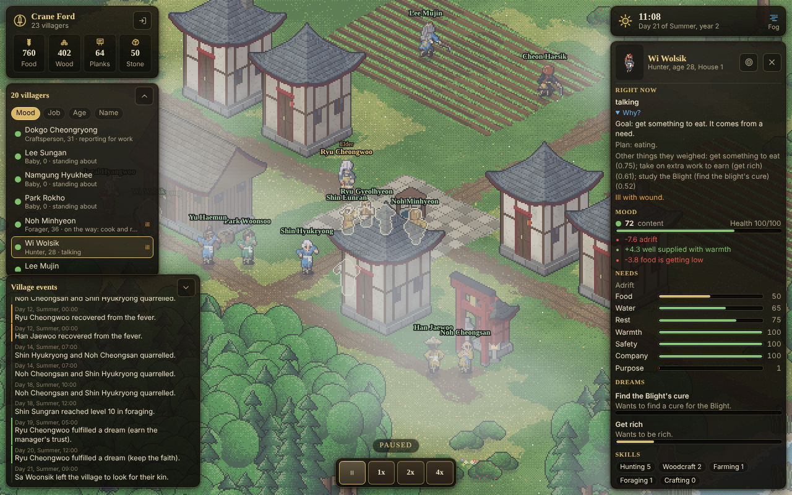
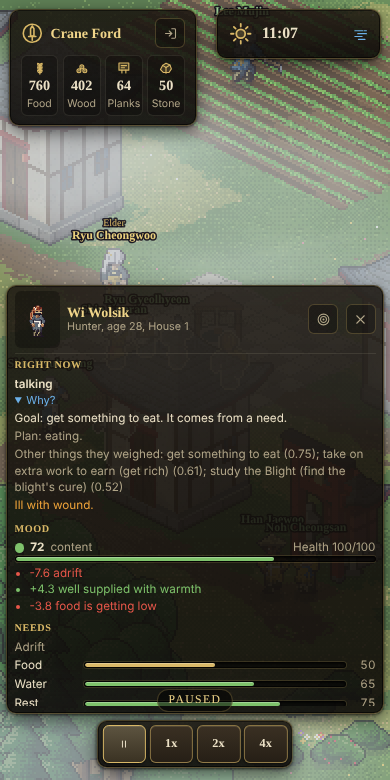

# M1: villagers with dreams

Milestone M1 of `docs/ROADMAP.md`, built on the branch `m1-villagers`, stacked on `m0-skeleton` (M0 is a separate pull
request; this one is opened against it and is retargeted to `main` when M0 is merged). The design is
`docs/notes/m1-agent-brain-spec.md`; the numbers it uses are `docs/notes/balance-v0.md`.

Done when: left alone for a game year at 4x the village is visibly alive, the villager sheet explains why each person acts, and
the bench is inside budget at 12 and 60 people. All three hold; the measurements are at the end of this file.

Screenshot from the in-page mock (`?mock=1`, seed 3, a village paused at day 21 of summer in its second year), 1280 x 800. On a
phone the list and the feed step aside when a villager is open and the sheet takes the lower half:

## What you get

### `packages/shared`

- `data/goods.ts`, `needs.ts`, `skills.ts`, `traits.ts`, `ambitions.ts`: the tables from the spec. Seven needs with their fall
  rates and words, 15 skills (`xpToNext = 40 * (lv + 1)^1.4`), 30 traits that change choices through modifier keys (work, rest,
  risk, social, crime, comply, learn, temper, romance, faith, kind, greed, curious, ambition, vigor) and have opposites, 25
  ambition kinds with their weights and the traits that pull people to them, 13 goods.
- `data/actions.ts`: **the action library**, 74 rows, 69 of them active (survival, food, materials, crafting, care, social, conflict, duty,
  life, construction). A row is data: where it happens, how long it takes, which skill speeds it, the hours and seasons it is open
  in, and (for what the planner may use) what it needs in the hands and what it gives. The construction rows are there and marked
  inactive until M2. Adding a row adds a possibility everywhere.
- `worldgen.ts`: the starting village gets a second field and a shrine (people marry and pray there).
- `protocol.ts`: `inspect` (client to server); `sheet` and `feed` (server to client); `roster` in `view` and `upd`; entities can be
  `hidden` (indoors) and `child`. `PersonBrief`, `PersonSheet`, `FeedEntry` are the shapes the UI draws.
- `rng.ts`: `state` is always read as an unsigned number, so a saved and restored generator serialises exactly like one that never
  stopped (found by the save and load test).

### `packages/sim` (new modules; each is small and has one job)

| module | what it does |
|---|---|
| `sites.ts` | The places actions resolve to: house doors, the store, the shrine, the fields, the well and the stream, stretches of forest, quarry and meadow, the plaza, the edge of the map. Derived from the map and the buildings, so M2 changes them without code changes. Each person **knows** a set of sites; knowledge spreads by talking and by walking past. |
| `people.ts`, `needs.ts`, `skills.ts` | Making people (households, traits, skills, looks), ageing, needs and mood with its causes, skill growth. |
| `planner.ts` | GOAP-lite: Dijkstra over an abstract state (where, what is in the hands, tool, need level, done), depth at most 6, at most 200 nodes, cached by goal and coarse state. A plan that cannot be found returns a **reason in words** ("no food in the store and no known place to find any"). |
| `goals.ts` | Where a day comes from: needs, the job board, ambitions and leisure, scored; a goal is kept for 20 game minutes unless something beats it by 25%; the **compliance** roll for jobs. |
| `jobs.ts` | The job board: standing work from what the village lacks (plant, tend, harvest, forage, fish, hunt, wood, stone, planks, herbs, cloth, tools, cook, bury the dead), refreshed hourly, claims survive a refresh. |
| `exec.ts`, `move.ts`, `actions.ts` | Running people every step: walking on the shared pathfinding, starting and finishing acts, joint acts (two people who have to meet), failure with a reason, the handlers of every action. |
| `social.ts`, `memory.ts` | Chat, gossip (facts keep a source and drift), courting, proposals, weddings, quarrels, apologies, gifts, bartering, stories, teaching, healing, brawls, duels, theft. Memories are bounded (40), fade (their weight halves every 20 days) and are the raw material of opinions and grudges. |
| `ambitions.ts` | Drawing ambitions, one rule per kind that turns the person's situation into the next goal or into a reason it is stuck, progress from milestones, finishing (a mood swing, a memory, a feed line, sometimes a new dream) and the daily review that ends a hopeless one **with its reason**. |
| `life.ts` | A day's life events: crops ripen, spoilage, coming of age, fever and recovery, ageing and death with mourning, pregnancy and birth, newcomers (a pool of eight per village, a few each season when there is food), leaving for the Outside and coming back with news. |
| `views.ts`, `feed.ts` | What the client sees: entity views, the villager list, the sheet and its explanations, the events feed. |
| `serialize.ts` | Snapshot version **2**, with a migration from M0's version 1 (the placeholder villagers become people with fresh minds; grain, firewood and timber become ration, wood and planks). |

### `packages/server`

`inspect` is validated like every other message. The host sends the villager list with `upd` (when it changed, at most every two
seconds), the events feed as lines are made, and the sheet of the watched villager once a second. The sim's event queue is now
drained every update (M0 let it grow).

### `packages/client`

- `ui/hud/people.ts`: the villager list (sort by mood, job, age or name; tap to select; collapses; remembers its state).
- `ui/hud/sheet.ts`: portrait and name; what they are doing now with **Why?** (the goal, where it came from, the plan, the other
  things they weighed, and what blocks it); mood with its three biggest causes; needs as bars with the cause of the lowest; dreams
  with progress and "stuck because"; skills; traits (tooltips); ties; what they remember; what they carry. A camera-follow button.
- `ui/hud/feed.ts`: the events feed (births, deaths, quarrels, weddings, dreams, arrivals, departures); a tap selects the first
  person a line names.
- Selecting by tapping a person in the world; indoor people are not drawn; children are drawn smaller; the stockpile card reads
  Food (rations and cooked meals together), Wood, Planks, Stone.

## How a villager decides

Every 100 ms slice a person is run: needs tick, then they walk, work, talk, or (when a plan runs out, a need turns critical, or
every ten game minutes, staggered by id) decide. Deciding lists the goals they could pursue, scores them
(`base * urgency * trait fit * skill fit / (1 + distance / 20)` inside a source), and takes the first that has a plan:

1. **Needs.** Below 62 a need calls for attention, louder as it falls (`((100 - n) / 100)^2 * 3`). A critical hunger, thirst,
   cold or collapse beats everything (loneliness never does). At night people go to bed even when they are not yet worn out.
2. **Jobs** from the board, in work hours, only when they are fed and rested. The person rolls to comply:
   `clamp(0.25 + loyalty/150 + mood/300 + trait bonus - risk - a competing dream, 0.05, 0.98)`. A refusal is remembered and shows
   on the sheet ("refused to cut wood: would rather not").
3. **Ambitions** in spare time (more in the evening). Each kind turns the situation into a goal: chat to get to know someone, then
   court, then propose, then marry at the shrine; practise a skill; teach an apprentice; save silver; pack and leave for the
   Outside; settle a score; and so on. A dream that cannot move says why and, after a long time, is abandoned with that reason.
4. **Leisure and duty:** chat, pray, wander, play (children), comfort someone low, slack off (the lazy), have it out with a rival,
   steal (the hungry and dishonest).

The goal then goes to the planner, which returns steps; the executor resolves each step to a concrete site the person knows,
walks there on the shared pathfinding, and runs the action. A step that cannot run fails **with a reason**; the goal is set
aside for a while; the reason is on the sheet, and after three game days of the same block it goes in the feed.

## Deviations from the spec, and why

| spec | built | why |
|---|---|---|
| sim step of 15 game seconds | the M0 slice of **100 game ms** stays; people decide on their own cadence (10 game minutes, staggered) | The server, the client clock and the renderer already run on the 100 ms slice. The cost is inside the budget (see the bench), so there was no reason to change the contract. |
| sleep restores 12 rest per hour | **9** per hour | At 12 people were rested after three or four hours and stood about the rest of the night. At 9 a night is about seven hours. |
| plans costed by exact distance and skill | plans use the **same cost model for everyone** (a representative site per kind, no skill speed, the need level in steps of 25) | A plan then depends only on its cache key, so plans can be shared between people and a loaded save continues exactly like one that never stopped. (The first version did not, and the determinism test caught it: cached plans were shared by reference and the executor wrote into them. Callers now get copies.) |
| deaths from age and illness | age (from 60, `balance-v0`), fever (worse for the very young and old, better with a nurse), a small yearly risk for everyone else ("illness"); starvation, thirst and cold | There are no plague, raids or wild animals yet (M3 and the events director). |
| three kinds of ambition wait for a building | `own_house`, `build_shrine` and `be_left_alone` post their request and wait ("waiting for a building plot"); they are abandoned with that reason after a long wait | As planned: M2 delivers construction. The soak shows them as the only kinds never fulfilled. |
| `escape_debt` | exists, but debt only arises from being caught stealing (a debt of 6 silver that grows) | There is no loan or fine system before M3. |
| talk text | not built; the feed and the sheet carry the story | The old game's dialogue composer is tied to the MMO. A "talk composer" can come when there is something to say beyond the feed. |

## Persistence

Snapshot version 2 holds the fields, the job board, the people (with minds), graves, the feed, fires, counters and the newcomer
pool. `restoreState` validates every field and fails with a `SnapshotError` it can explain. A version 1 snapshot (M0) is upgraded
in place: the people keep their names, looks and places, and get traits, skills, needs and a mind; the stock is renamed.

## Numbers

Measured in the cloud container that built this (Node 22.22). `npm run bench` and `npm run soak` reproduce them.

### `scripts/bench.ts`

Milliseconds of CPU per game day (average of 3 days after a warm-up; every person starts at home on day 0, so the days include
the morning rush on the planner). Budget: under 20 ms per real second of 1x, i.e. 7200 ms per game day. All four sizes are
inside it, and 300 people use about 38% of it.

| people | ms per game day | ms per real second at 1x | ms per 100 ms tick |
|---|---|---|---|
| 12 | 94.9 | 0.26 | 0.026 |
| 60 | 395.7 | 1.10 | 0.110 |
| 150 | 1098.4 | 3.05 | 0.305 |
| 300 | 2745.6 | 7.63 | 0.763 |

Building the data for the client (`view()`, with the villager list and the feed) costs 0.05 ms at 12 people and 0.25 ms at 300
(0.5 ms with the JSON), five times a second at most.

### `scripts/soak.ts`

Six game years on five seeds (`npm run soak -- --years 6 --seeds 1,2,3,4,5`), starting with 12 people. About 50 s of CPU per
seed. The village is never left to starve: the lowest food stock of the run, in person-days, is the column "food low".

| seed | people at the end | lowest | births | deaths | marriages | left and came back | dreams fulfilled / given up | food low | mood avg |
|---|---|---|---|---|---|---|---|---|---|
| 1 | 22 | 11 | 5 | 3 | 1 | 10 / 10 | 109 / 36 | 11.2 | 76.0 |
| 2 | 29 | 10 | 13 | 4 | 3 | 7 / 7 | 112 / 21 | 9.9 | 75.1 |
| 3 | 26 | 11 | 10 | 4 | 2 | 7 / 7 | 69 / 25 | 12.1 | 76.6 |
| 4 | 26 | 11 | 7 | 1 | 0 | 9 / 9 | 84 / 24 | 10.6 | 77.0 |
| 5 | 27 | 11 | 8 | 1 | 2 | 3 / 3 | 88 / 22 | 10.7 | 76.1 |

Arrivals are 8 on every seed (the pool). Deaths are old age, fever and illness; none from hunger, thirst or cold once the
village is running. Nobody collapsed from exhaustion. Chats, gossips, thefts and quarrels are in the full output.

**Acceptance (spec section 14), one by one**

1. *Alive.* People work (2100 to 4400 jobs done per six years), rest, talk, change what they do, court, marry, have children,
   leave for the Outside and come back, are ill, and die of age and fever. See the screenshot and the feed.
2. *Ambitions work.* Across the five seeds every kind that does not wait for construction was fulfilled at least once
   (`every ambition that needs no construction was fulfilled at least once`); the three that wait were abandoned with their
   reason. About one dream in five that ended was given up (128 of 590), each with a recorded reason.
3. *No stuck people.* The longest time anybody was blocked with no way forward, sampled every day, is **0.2 game days**; the
   longest run of days in which someone was idle at noon is 3 (1 or 2 on the other seeds). A block that lasts three days is put in the feed
   by the sim.
4. *Explained.* `sim.sheet(id)` answers for every person on the map (a test walks the whole village); the sheet shows the goal,
   its source, the plan, the runners-up and the blocker.
5. *Deterministic.* The golden test (seed 1337, four game days) compares a digest of the serialised village and four counters;
   another test saves in the middle of a run and checks the restored village continues byte for byte; another checks any chunking
   of `step` gives the same result. The first version of the planner cache broke this and the tests found it.
6. *Fast enough.* See the bench: inside the budget at 12 and 60 people, and measured at 150 and 300.
7. *Tests.* Unit tests (`agents.test.ts`) for needs, skills, goal scoring, the planner (including blocked plans and the
   take-it-from-the-store-and-put-it-back loop), compliance, relationships, ambitions, memory decay, leaving, and the data
   tables; `sim.test.ts` for determinism, serialisation (including the version 1 migration), the calendar and the village's first
   winter.

### Tests

`npm test`: 280 tests in 27 files, all passing: shared 5, sim 62, server 59, client 154. Typecheck is clean for all five projects
(`npm run typecheck`). `npm run build` produces the client and `dist/server.mjs`.

## What I could not verify, and known rough edges

- **Not played at length in a browser.** The screenshots come from the in-page mock with the real sim; I watched about two game
  days at 4x and a saved village from day 140. The server path (inspect, sheets, feed) is covered by the integration test, not by
  a long live session.
- **Chat and gossip are cheap and frequent** (tens of thousands over six years). They are what fills spare time, and they keep
  company up; they may need a cost or a cooldown once there is more to do (M2 and M3 will give people more to do).
- **Few weddings.** One to three per six years in a village this small: there are only so many unmarried adults who are not kin.
  The ambition is abandoned with a reason when it cannot work ("no suitable partner", "turned down twice").
- **The feed mentions every duel, quarrel and illness.** It is a feed, not a report; M3 adds the daily and seasonal summaries.
- **Babies under three** stay indoors with their family: they are alive and counted, but they are not drawn or simulated as
  walkers.
- **Mobile layout** was checked at 390 px wide only in the screenshot above.
