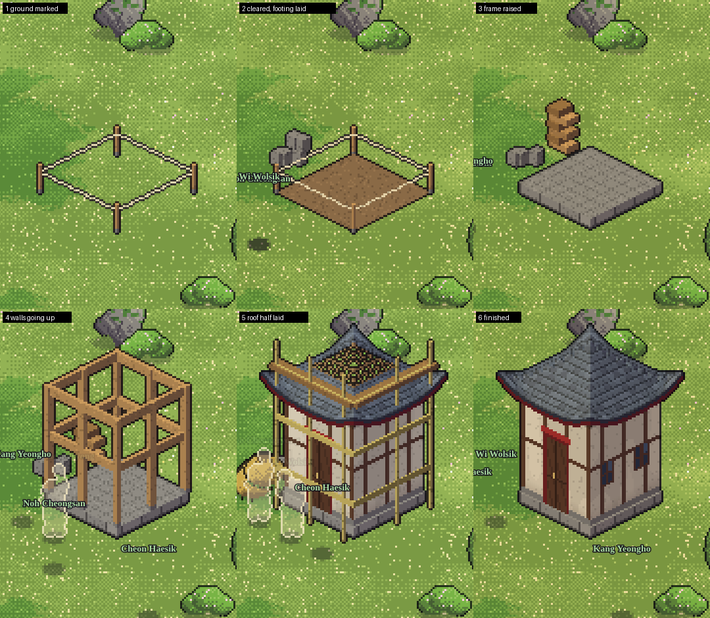
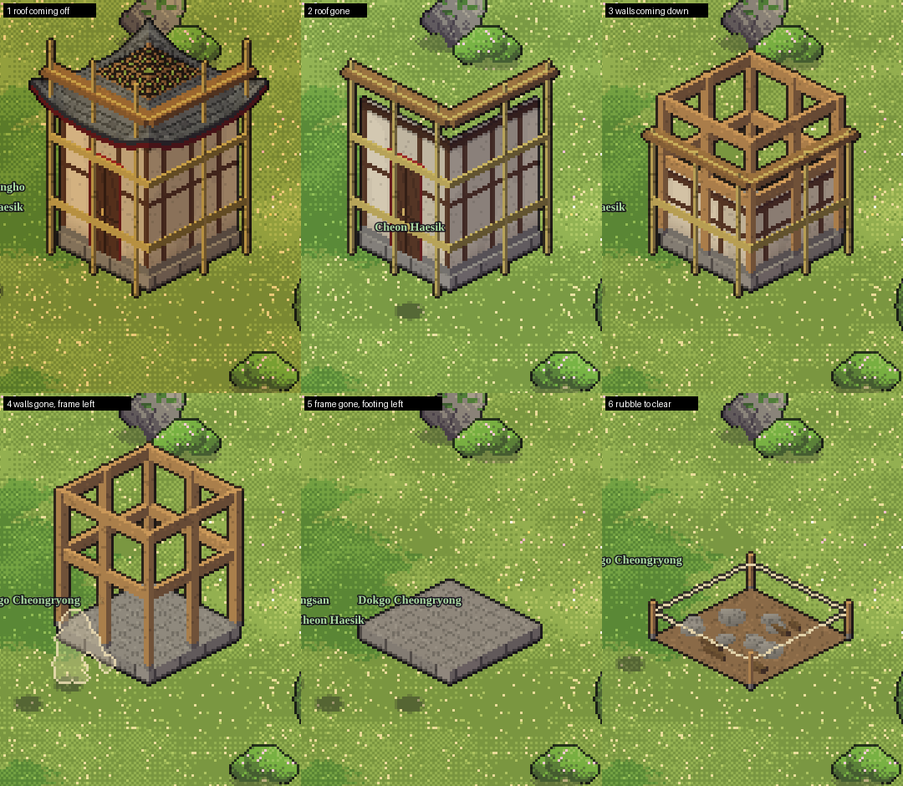
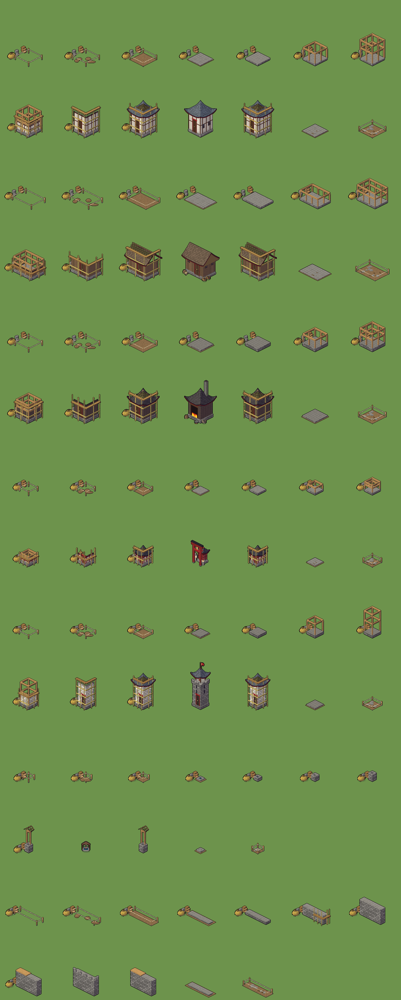
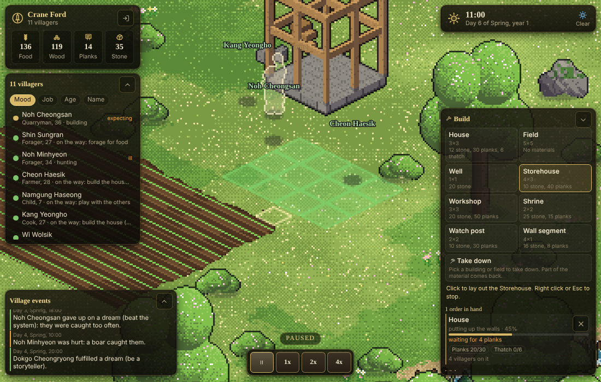
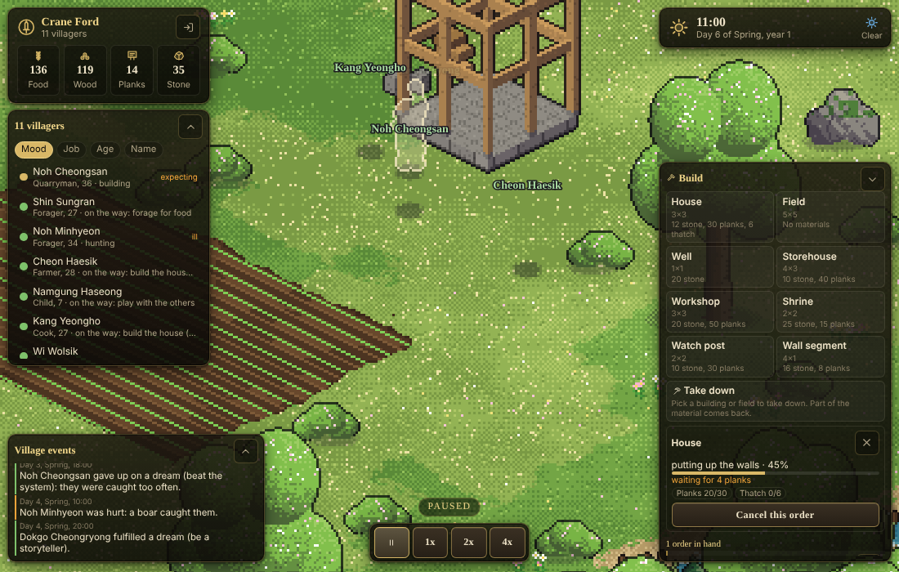

# M2: visible construction and demolition

Milestone M2 of `docs/ROADMAP.md`, built on the branch `m2-construction` (from `main` at the merge of M0, M1 and the follow-up
fixes). The design inputs are `docs/notes/m2-construction-feasibility.md` (how to draw it) and section 5 of
`docs/notes/balance-v0.md` (costs, stage split, builder speed, demolition).

Done when: ordering a house shows people fetching materials and the house rising stage by stage; demolishing one takes it down
in reverse; progress shows in the orders panel. All three hold, in the sim tests, in the in-page mock and through the real
server socket (the numbers are at the end).

A house from the first stake to the finished roof (12 game days into a village's life, in the in-page mock, seed 3; the people
who stand about are walking or building, the ghost outlines are the see-through of villagers behind a building):

The same house being taken down, in reverse, ending in a heap of rubble that is then cleared:

The first set of buildings, every stage at 0% and 50%, then finished, then taken down (generated by `scripts/stages.ts`):

The build menu with a storehouse laid out (green: it may go here; the ringed tile is where the door opens) and the order list
below it, and the progress read-out of a house that was tapped:

## What you get

### The rules (`packages/shared`)

- `data/blueprints.ts`: **the blueprint table.** For each of the eight kinds (house, field, well, storehouse, workshop, shrine,
  watch post, wall segment): size, labour, the stages (`cleared`, `foundation`, `frame`, `walls`, `roof`, or `cleared` and
  `ploughed` for a field) with their share of the labour and the materials each stage needs. Labour and costs are the numbers of
  balance section 5 (a house: 120 units, 12 stone, 30 planks and 6 thatch, stages 5/15/25/30/25%). The same file holds
  `canPlace`, the placement rules that the client uses to colour the footprint and the sim uses to accept the order, so the
  preview and the server cannot disagree.
- `terrain.ts`: `ConView` (`mode`, stage `done`, `pct` of the stage, the `pile` of material on the plot) on `BuildingDef` and
  `PlotDef`: this is all the client needs to draw a building under construction or demolition.
- `protocol.ts` (**PROTOCOL_VERSION 2**): `build`, `demolish`, `cancel` from the client; `orders` and `wishes` in `view` and `upd`
  (`OrderView`: kind, stage, overall %, what it waits for in words, material delivered against needed, how many villagers are on
  it); `center` in the world payload; `carry` on entities. The server validates the new messages with zod like the old ones.
- `data/actions.ts`: the construction rows are active at the new place kind `buildsite` (`build`, `demolish`, `clear_rubble`,
  `deliver_material`), plus `cut_thatch`.

### The sim (`packages/sim`)

- `construct.ts`: **the order engine.** An *order* (`st.orders`) owns the work; the building or plot it is about carries a `con`.
  - `placeOrder` checks `canPlace` and that the door can be reached from the green, puts a marked plot on the map and the order on
    the list. A field is a plot; everything else is a building with a `con` from the first minute (so it blocks the tiles it stands
    on, and anyone standing there is moved out).
  - **Jobs.** An order posts *haul* jobs (material from the store to the plot) and a *build* job to the job board; people take them
    through the M1 brain: need, goal scoring, compliance, the planner, the sheet's "Why?" ("I am putting up the walls of the
    house because it is the best job I can do for the village"). Materials for a stage must be on the plot before the stage starts,
    so people are seen fetching before anything rises.
  - **Labour.** Units are person-hours of a builder at skill 4 (balance section 5); a builder of skill `s` works at
    `skillSpeed(s) / skillSpeed(4)` per hour (the 1 + 0.08 x skill of the balance sheet). Stages go in order; the last stage
    finishes the building (a house becomes a home and the family that wanted it moves in; a storehouse a second store; a well a
    water site; a field a plot people can sow; a shrine a place to pray).
  - **Demolition** runs the stages backwards at 40% of the labour each, returns half the material of each stage to the store (30% of
    planks and thatch: they splinter and rot), leaves rubble that takes 5% of the build labour (at least 2 units) to clear, and then
    the plot is empty. A field's crop goes with it; a house's people are given another home.
  - **Cancel.** An order nobody has touched just goes away and the delivered material comes back; one that has begun is taken
    down again (the same way as a demolition); cancelling a demolition builds the building back up.
  - **Ambitions.** `own_house` no longer waits for "the means to build": the person pitches in on the house the manager ordered
    (their goal is the build job, and the sheet says so) and moves in, with their family, into a house nobody lives in as soon as
    one stands; `build_shrine` helps raise the shrine; `be_left_alone` wants a house at least 12 tiles from the green. Villagers
    never place orders themselves (the `by` field of an order is there for that, and holds "you" today). While nobody has ordered
    what they wish for, the wish shows in the `wishes` list so the manager sees "Han wants a house of their own".
- `sites.ts`: the sites follow the buildings (a finished well is a water site, a second storehouse a second store, a new field a
  field) with stable ids (those of the starting village are fixed, new ones are offset), so what people *know* survives saves.
- The map's own grid is never edited (every boot and every client has the same one): a small overlay says which tiles now hold
  something and which tiles of a starting building are free again, and path finding and `canPlace` read it.
- `serialize.ts`: snapshot **version 3** (orders and the id counters) with a migration from version 2 that gives an old village
  an empty order list and the counters its buildings imply. A test builds a house through a save and a load in the middle of the
  job and checks that the run continues exactly as one that never stopped.

### The art (`packages/client/src/art`, `render`)

- `construction.ts`: `progressOf(kind, con)` turns a `ConView` into what stands (`ConProgress`: how much footing, frame, wall and
  roof; the material piles; rubble; the ground) and `staged` draws exactly that into the same `Scene3D` the finished buildings use.
  Footprint, wall height and roof rise come from one `LOOK` table per kind, so a stage matches the finished building.
  - the plot: four stakes and a cord; cleared ground is a patch of bare soil that fills in as the clearing goes;
  - the foundation rises from the ground to the plinth; the frame is posts and beams up to full height, then walls rise from the
    footing (door when the wall is high enough, windows when it is done);
  - the roof is laid **row by row from the eave** (`RoofOpts.cover`); what is not laid yet is bare rafters and battens you see
    through;
  - bamboo scaffolding on the two visible faces while the walls and roof go up;
  - material piles beside the plot (planks, stone, thatch, in three sizes) from the `pile` the sim reports, so you see the
    material arrive;
  - demolition is the same run backwards, with a growing heap of broken stone and splintered planks, and at the end only rubble
    (that shrinks as it is cleared).
- `buildings.ts`: `genConstruction` next to `genBuilding`; the new kinds' finished art (`workshop` is the smithy, `watchpost` the
  tower, `well` the well sprite, `wall` a crenellated stone slab laid either way).
- Sprites are cached per (building, season, state) where the state is the quarter of the stage and the three pile levels
  (`conKey`); a building keeps only its latest sprite, so the cache stays small however long the job.
- `render/world.ts`: field ground follows the plots (cleared = bare earth, ploughing turns it to furrows tile by tile, a finished
  field is farmland, farmland of the starting map that no plot covers any more turns to grass) with the affected chunks repainted.
- Builders: new acts `build` (hammer), `dig` (pick for the rubble), `saw` (long strokes; also the existing plank sawing, which was
  drawn as sweeping before), and a load **carried in both hands** while walking and standing: a board, a log, a stone, a bundle
  of thatch (`EntityView.carry`).

### The client UI (`packages/client/src/ui/hud`)

- The **build panel** (bottom right, `B` shows or hides it): the eight kinds with size and cost, a take-down tool, a hint while a
  tool is in hand. With a kind picked the pointer lays out the footprint: green where it may go, red where it may not (and a
  toast with the reason, in words, when you click); the tile in front of the door is ringed; `R` turns a wall; right click or `Esc`
  puts the tool away. On a touch screen the first tap moves the marker, the second confirms. The server checks the order again.
- The **order list** under the menu: what each order is doing in words ("putting up the walls, 45%"), why it waits ("waiting for
  4 planks"), the material that has arrived against what it needs, how many villagers are on it, a cancel button, and a click to
  look at the site.
- Tapping a building or field shows its **read-out** (stage and progress, what is missing, cancel the order, or take it down).
- **Wishes**: who wants a house or a shrine.

## What differs from the spec, and what is not done

- **The workshop has no effect yet.** It is built, drawn (the smithy art) and stands; tools and cloth are still made where M1
  made them. Giving it work (a speed bonus, the place where `make_tool` and `weave_cloth` happen) belongs with the economy in M3.
- **Some finished sprites differ from their last stage.** The workshop, watch post, shrine and well reuse existing art when done
  (smithy, tower, shrine with its gate, the well sprite), and the stages are an approximation of the same footprint (a plain
  walled building, a stone tower with a roof, a stone ring with two posts and a small roof). Nothing jumps in size or position,
  but the look changes when the last unit of labour goes in.
- **Cleared ground** for a building is drawn inside its sprite (a patch of soil) and not as a terrain overlay; only fields change
  the terrain tiles.
- **A wall segment** is a building of four by one tiles; it blocks the way but does not connect to the old wall tile system
  (palisade and wall objects of the map), so two segments laid end to end look like two slabs.
- **Builder animations** cover hammering, digging, sawing and carrying a load. There is no separate "lay tile" pose: roofing uses
  the hammer.
- **Touch placement** needs a second tap to confirm (there is no hover on a phone); there is no drag-to-place.
- **Priorities.** Haul and build jobs are priority 5 on the job board (the same as bringing in a harvest or burying the dead);
  demolish and rubble are 4 (the same as sowing). At 3 a demolition got almost no workers in the experiments, so the numbers are
  there on purpose. The standing jobs for stone, planks and thatch rise to 4 while orders are waiting for that material.
- **Pace.** In the screenshots' village (seed 3, eleven villagers, skill as it comes, the first spring) a house next to the green
  took 96 game hours from the order to the finished roof, and one 17 tiles out (the one in the pictures) took 165 hours; taking it
  down and clearing the rubble took about 100 hours. The hauling of 12 stone, 30 planks and 6 thatch is part of it, and
  everybody still has to eat, sleep and tend the fields. That is slow on purpose for a first house in a hungry spring (a game
  day is six real minutes at 1x, so 165 hours is about 40 minutes at 1x or 10 at 4x), and it gets faster with builders of higher
  skill (`skillSpeed`) and more hands. Another seed or season will differ; this is the number to tune in M3 with the economy.

## Tests

- `construct.test.ts` (22): placement rules and reasons, the order limit, blocking and moving people out, walls both ways, a house
  from order to finished with materials hauled and stages in order, never less drawn at a later stage, fields, wells and
  storehouses taking their roles, refunds, demolition in reverse with rubble, cancelling in every state, the build job in the
  sheet's "Why?", the own-house ambition, the wish list, save and load in the middle of a build, the migration from version 2.
  The long ones carry explicit timeouts (this box runs the whole suite in under half a minute; the home server is about five
  times slower).
- `art.test.ts` (construction stages): every stage of every buildable kind draws something, successive stages differ and the
  last is bigger than the first, the sprite is deterministic, demolition shows the same parts as the build run backwards, the
  cache key changes with what is visible and not with the order id; loads and the saw change the character sprite.
- `buildLogic.test.ts`: the footprint under the pointer, valid and invalid spots with their reasons, finding what is under a
  tile, the words of an order. `render.test.ts`: field ground follows the plots. `integration.test.ts`: a client orders a house
  over the real socket, sees the order and the `con` in the next update, is refused with a reason for a bad spot, cancels it, and
  a message with an unknown kind is rejected.
- `sim.test.ts` **golden run**: the digest changed (`4048763c:32766` to `9d76eb34:33007`) and the facts did not (12 people, 28 jobs,
  92 meals, 74 chats on day 4). Diffed against the M1 snapshot of the same run: snapshot version 3 with the order list and counters,
  one new standing job (cut thatch), a longer ban-key format and one ambition's "stuck" sentence. Nothing in how the village lives
  changed.

## Measurements

Measured on the cloud box this was built on (Node 22; the home server, an i5-7500, is about five times slower).

### Bench: `npm run bench`

Cost of the simulation per game day, as in M1, then the same with the order list **full**: up to 24 build orders of every kind at
once (most of them waiting for material or hands, so the job board carries haul and build jobs for each and every one stands in
some stage), three game days:

| people | ms per game day | ms per real second at 1x | ms per tick | within the 20 ms budget |
|---:|---:|---:|---:|---|
| 12 | 107 | 0.30 | 0.030 | yes |
| 60 | 374 | 1.04 | 0.104 | yes |
| 150 | 1157 | 3.21 | 0.322 | yes |
| 300 | 3013 | 8.37 | 0.837 | yes |

| people, 24 orders in hand | ms per game day | ms per tick | against no orders | orders left after 3 days | finished |
|---:|---:|---:|---:|---:|---:|
| 12 | 80 | 0.022 | 1.35x | 23 | 1 |
| 60 | 418 | 0.116 | 1.33x | 20 | 4 |
| 150 | 1354 | 0.376 | 1.24x | 20 | 4 |
| 300 | 3446 | 0.957 | 1.15x | 20 | 4 |

A full order list costs between 15% and 35% more per tick (a few hundredths of a millisecond at 12 people): the job board and the
sites are rebuilt only when an order or a building changes, and hauling and building use the same planner cache as the rest.
Even at 300 people with 24 orders the sim uses 9.6 ms per real second at 1x of the 20 ms budget. The client side costs nothing
per tick: a building sprite is made once per visible state (a few milliseconds) and cached.

### Soak: `npm run soak -- --years 6 --seeds 1,2,3,4,5`

SOAK_NUMBERS

## How to try it

- In the page mock (no server needed): `npm run dev:client`, open `http://localhost:5173/?mock=1&seed=3`, sign in with any
  name and a password, press `B`, pick a house, click on open ground (green is allowed), click again to confirm. Press `3` for 4x
  speed and watch the villagers fetch planks and stone from the store, the stakes turn into a footing, a frame, walls with
  scaffolding and a roof. Tap the house to read its progress; pick "Take down" and tap it to see it come down.
- With the server: `npm run dev` and the same, without `?mock=1`.
- `npx tsx --tsconfig scripts/tsconfig.json scripts/stages.ts out.png [kind,kind]` writes the contact sheet of the stages.
