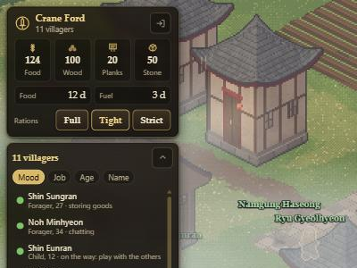

# M3: economy, seasons and survival

Milestone M3 of `docs/ROADMAP.md`, built on the branch `m3-economy` (from `main` at the merge of M2). It was written in the owner's main
session, not by a cloud session. The design inputs are `docs/notes/balance-v0.md` (sections 2 to 4, 7 and 8) and the M1 and M2 notes.

Done when: the soak script shows survival rates in a sensible range across seeds, and a winter without preparation hurts while a
prepared village comes through. Both are measured below (the winter in a test, the survival in the soak).

## What you get

### The economy (`sim/economy.ts`, `shared/data/balance.ts`)

All the tuning numbers are in one object, `BAL`, in `packages/shared/src/data/balance.ts`, so the soak can sweep them.

- **Hearths.** Every evening at 17:00 each finished house with somebody living in it burns wood from the village store and has its fire
  lit for the night (14 hours): 6 wood a winter day, 2 in spring and autumn, none in summer. A house the wood does not reach is cold
  (people in it lose warmth through the night, and the feed says "There is no firewood left for N of the hearths"). A person who
  is cold still lights the hearth by hand as before.
- **Winter is harder.** A house with no fire lets in half of the cold (it was a third); hunting gives 30% and fishing 45% of their
  usual in winter; farming and foraging were already shut in winter. The standing jobs aim at a winter of wood by the autumn (26 days
  of the winter burn, in the village's real number of houses), press harder the emptier the store is, and in winter keep the rest of
  the season covered.
- **Spoilage.** Raw food loses 0.4% a day, cooked food 0.8%, herbs 1%. Winter halves it, a second storehouse (the cold store) takes 40%
  off, and every tile the Blight has reached past the shrines' ward adds 12% to it.
- **Rationing.** The manager can set the rations to normal, tight or strict (`{ t: 'ration', level }`, the three buttons on the village
  card). A tight ration gives a person 80% of a portion for 90% of its points, a strict one 60% for 78%: the store lasts longer, the
  people are hungrier and in a worse mood ("on short rations").
- **Status.** The village card shows the days of food and the days of winter heating the wood in the store covers (red when under
  8; the fuel one only from autumn), the rations lever, and an alert line: raiders expected, sickness in the village, or how far the
  Blight has reached.

### The events director (`sim/director.ts`)

Runs once a game day. Every number is in `BAL.director`.

| event | when | what happens |
|---|---|---|
| **Bad harvest** | from day 48 (autumn of year 1), 1 ripening in 5 | the field keeps 70% of its yield; the feed says why (hail, mildew, drought, damp) |
| **Blight creep** | one tile a month from the start | spoilage grows, foragers find less, fever is likelier; each finished shrine holds back two tiles |
| **Raid** | first around day 40, then about every 26 days, from 3 to 5 raiders and one more each year | announced a day ahead ("Smoke on the ridge"); a watch job opens; on the day the village's defence is weighed against the raiders |
| **Plague** | from year 2, about 1 in 6 years, at least 160 days apart | 3 to 6 people fall ill (up to 20% to 45% of a small village); the sick pass it on to their household (5% a day each), lose health faster than the body mends it, recover after 3 days or more (likelier with a nurse); the old and the young die first |
| **Refugees** | about 1 in 120 days, 90 days apart | 2 to 5 people arrive when there are at least 12 days of food, and go on when there are not |
| **Travelling master** | about 1 in 130 days, 60 days apart | stays 12 days and teaches the three with the lowest level in one skill |

Nothing hostile comes at a village of fewer than 6 people (a raid is put off, a plague does not start under 8), and a village with
less than 8 days of food gets one raider fewer.

### Defence

A raid is a weighing, not a fight on the map. The village's **defence** is the sum of: every adult able to fight (0.3 each, plus 0.25 per
level of fighting; 1.7 times as much for a person who stood watch in the last day or is on watch now; halved for the ill), 4 per finished
watch post (up to 5) and 1.5 per finished wall segment (up to 6 in all). The raiders count 3.4 each. With the ratio of defence to attack:

- **1.15 or more:** driven off. Nothing is lost; the watchers learn fighting and everybody is a little prouder.
- **0.6 to 1.15:** a skirmish. The raiders are beaten back but take 7% of the food, wood, planks, cloth and tools, and one to three people are hurt.
- **under 0.6:** the village is overrun. The raiders take 30% to 45% of those goods; two to five or more people are badly hurt and may die;
  everybody loses 8 loyalty and some of those who hold least to the village leave in fear.

The job board posts a `watch:duty` job (standing watch) when there are watch posts, two places for each, and two more while a raid is
expected, at the highest priority. Wounded people heal as before.

### The save (`sim/serialize.ts`)

Snapshot **version 4** adds the rationing level, the hearths' day and the director's memory (`st.dir`). A village from M2 (version 3) loads:
it gets a fresh director whose first raid is 40 days or more from the day it is loaded, so an old village is not raided on its first
day back. Protocol **version 3** adds `status` to the view and updates and the `ration` message.

## What differs from the spec, and what is not done

- **Raiders are not on the map.** A raid is resolved in the director from the defence, and shows in the feed. There is no combat on the
  map, no raiders walking in, no gate. The old game's skirmish idea is kept as the weighing of defence against attack. Showing the raid
  (raiders at the edge, people running to their posts) is art and animation work for a later pass.
- **No gates.** A wall segment adds to the defence like any other; walls do not yet close a perimeter and there is no building called a gate.
- **Refugees are decided by the sim.** The roadmap's "accept or refuse; each choice has costs" needs an offer in the UI; for now the village
  takes them in if there are 12 days of food and turns them away if not (the feed says which). The offer and the answer belong with the
  orders and rules of M4.
- **Rationing is one lever for everybody.** There are no separate portions for the working and the old or the young.
- **No separate cloth economy.** Cloth is made as in M1 (herbs into cloth, one job) and used for clothes; nothing new was added about
  who has warm clothes before winter.
- **Stone** is as in M2 (quarried, used in buildings).
- **Reports.** The daily and seasonal summaries are M4; the feed carries the events (`raid`, `plague`, `cold`, `harvest`, `blight`,
  `refugees`, `master` kinds, coloured in the feed).
- **Nobody is forced to survive.** Villagers prepare for winter without being told (the standing jobs aim at it), so a village left alone
  comes through most winters; what a winter without preparation costs is shown in the test below, and what no manager costs is in the soak.
- The soak's **do-nothing target** of the balance sheet ("a do-nothing player survives year 1 under 10%") was written for a village
  whose people do nothing by themselves. They do not here, so the soak measures a village with no manager (`--no-manager`): its raids go
  through, its stores are looted, but it does not die in the first year. See the numbers.

## Tests

- `m3.test.ts` (23): hearths burn wood by season and house, once an evening, and leave a cold house and a feed line when the wood is
  gone; the wood aim; spoilage by season and storehouse; rationing levels, the command and its rejections, and that strict rations use less
  of the store over three days; the status; raids (announced a day ahead, put off for a tiny village, driven off by a prepared one,
  overrunning an undefended one with loot, wounds and a feed line); what counts towards defence (and what does not: a post still being
  built); the watch job; bad harvests at about one in five and none before autumn; plague (starts with 3 to 6 sick, kills one who is near
  death, lets the rest recover); refugees taken in or turned away; a travelling master; the Blight and the shrines' ward; the save from
  version 3 and a round trip of the director.
- **A winter** (`a winter without preparation hurts...`): from the same autumn, one village is given a full winter store (340 food, 700 wood)
  and one almost nothing (25 food, 15 wood). The prepared one never has a cold night, never has fewer than three days of food and
  loses nobody; the bare one runs the food store down to under one day and its people are hungrier.
- `integration.test.ts`: a client sets the rations over the real socket, sees the status change in an update and a note, and is refused
  a level that does not exist.
- The M2 save and load test now compares the saves as data: a property that was `undefined` in the live state vanishes in a round trip,
  which changes only the order of the keys (it made a correct run look different).
- The golden run (seed 1337, four days) moved: digest `9d76eb34:33007` to `e7c7e166:35873`, and its facts from 28 jobs, 92 meals and
  74 chats to 38 jobs, 93 meals and 16 chats. The cause is the hearths: from the first evening they burn the store's wood, so more
  people are sent to the woodpile in the first days and talk less. Over the soak years chats are in the tens of thousands, so the village
  is as sociable as before. The director draws from its own forked random stream, so it does not shift the village's.

## Measurements

### Bench: `npm run bench`

Cost of the simulation per game day on this computer (Node 24, Windows), three game days per size. The hearths, the director and the
watch job are a few hundredths of a millisecond per tick.

| people | ms per game day | ms per real second at 1x | ms per tick | within the 20 ms budget |
|---:|---:|---:|---:|---|
| 12 | 62 | 0.17 | 0.017 | yes |
| 60 | 223 | 0.62 | 0.062 | yes |
| 150 | 609 | 1.69 | 0.169 | yes |
| 300 | 1809 | 5.02 | 0.502 | yes |

### Soak: `npm run soak -- --years 5 --seeds 1,2,3,4,5,6,7,8 --quiet` (and the same with `--no-manager`)

Five game years on eight seeds, starting with 12 people. "Survives" means at least 6 people at the end of the year (fewer cannot farm, guard and
raise children). The scripted manager of M2 now also sets the rations (tight under 7 days of food, strict under 3.5, back to full over 14), builds a
watch post for every ten people (up to three, from day 45) and a wall segment for every eight (up to four, from day 120).

**With the scripted manager.**

| seed | people at the end of years 1 to 5 | raids (driven off / skirmish / overrun) | goods lost | deaths (causes) | left the village |
|---|---|---|---|---|---|
| 1 | 16, 21, 23, 25, 28 | 16 (1 / 12 / 3) | 2136 | 2 (old age 1, illness 1) | 11 |
| 2 | 17, 14, 13, 11, 10 | 16 (0 / 1 / 15) | 5503 | 4 (fever 1, raiders 1, plague 1, illness 1) | 17 |
| 3 | 20, 28, 34, 39, 39 | 16 (16 / 0 / 0) | 0 | 5 (illness 2, plague 2, old age 1) | 6 |
| 4 | 15, 18, 24, 31, 31 | 16 (12 / 3 / 1) | 471 | 1 (old age 1) | 13 |
| 5 | 19, 25, 32, 32, 38 | 17 (13 / 3 / 1) | 944 | 3 (old age 1, illness 2) | 12 |
| 6 | 17, 21, 21, 21, 27 | 17 (16 / 1 / 0) | 82 | 7 (plague 5, illness 2) | 13 |
| 7 | 19, 30, 31, 36, 40 | 15 (14 / 0 / 1) | 330 | 2 (raiders 1, old age 1) | 9 |
| 8 | 15, 10, 9, 10, 11 | 16 (0 / 0 / 16) | 5963 | 3 (illness 1, raiders 2) | 23 |

survival (population of at least 6 at the end of the year): year 1 100% (8/8), year 3 100% (8/8), year 5 100% (8/8).  
population at the end, survivors: 28, 10, 39, 31, 38, 27, 40, 11 (average 28.0).

**Without a manager (`--no-manager`).**

| seed | people at the end of years 1 to 5 | raids (driven off / skirmish / overrun) | goods lost | deaths (causes) | left the village |
|---|---|---|---|---|---|
| 1 | 18, 12, 10, 7, 4 (collapsed in year 5) | 16 (0 / 0 / 16) | 5590 | 4 (illness 1, raiders 3) | 26 |
| 2 | 11, 9, 9, 6, 8 | 16 (0 / 0 / 16) | 4569 | 2 (fever 1, raiders 1) | 18 |
| 3 | 17, 13, 12, 9, 6 | 16 (0 / 0 / 16) | 4495 | 4 (illness 2, old age 1, raiders 1) | 28 |
| 4 | 14, 15, 11, 9, 7 | 16 (0 / 0 / 16) | 4320 | 4 (raiders 2, fever 1, old age 1) | 24 |
| 5 | 11, 12, 9, 5, 8 (collapsed in year 4) | 15 (0 / 0 / 15) | 3964 | 0 (none) | 26 |
| 6 | 17, 22, 25, 25, 26 | 15 (0 / 11 / 4) | 2658 | 4 (illness 2, fever 2) | 8 |
| 7 | 17, 14, 9, 8, 4 (collapsed in year 5) | 14 (0 / 1 / 13) | 3276 | 6 (raiders 2, illness 3, plague 1) | 25 |
| 8 | 22, 31, 33, 37, 40 | 16 (0 / 14 / 2) | 1966 | 1 (fever 1) | 10 |

survival (population of at least 6 at the end of the year): year 1 100% (8/8), year 3 100% (8/8), year 5 63% (5/8).  
population at the end, survivors: 8, 6, 7, 26, 40 (average 17.4).

How to read them:

- **Raids are the pressure.** About one every 26 days (14 to 17 in five years, one more raider each year). A village with no manager has no posts and
  no walls, so nearly every raid overruns it (13 to 16 overruns in six of the eight runs, 2000 to 5600 goods lost): people are hurt, a few die, and many
  leave in fear (8 to 28 a run). Six of the eight unmanaged villages end under 9 people, and three of them fall below 6 at some point. With the
  manager's posts and walls, five of eight drive off almost every raid (0 to 3 overruns); two (seeds 2 and 8) fell behind the raiders, were overrun 15 and
  16 times and ended at 10 and 11 people. Preparation matters, and it has to keep up with the raiders.
- **People mostly leave rather than die.** Deaths are 0 to 7 a run in both modes (raiders, plague, fever, illness, old age).
- **Plague** is rare in 5 years (about one in six years) and killed up to 5 in one managed village.
- **Winter did not kill anybody in these runs** (no deaths from hunger or cold in 16 runs): the villagers prepare for it by themselves (the
  standing jobs aim at a winter of wood and the fields feed them), so a village that is left alone still comes through. It bites when the
  stores are cut, as the winter test shows. If winter should be a killer in itself, the next knobs are the starting stock, the winter wood
  burn and the share of food the fields give.
- **Against the balance sheet's bands** (section 8: survive year 3 at 70% to 85% and year 5 at 50% to 70%): the village with a manager is above them
  (100% in all three, though two of eight are small at the end), the village without one is inside the year 5 band (100%, 100%, 63%). The "do-nothing
  player survives year 1 under 10%" row cannot hold in a game where the people act by themselves. I left the managed village on the easy side on purpose:
  this is the first playable pass of the pressure, and making it deadlier is a matter of two numbers (`BAL.defence.perRaider` and
  `BAL.director.raid.perYear`). Only the raid, plague and winter-food numbers were moved from the sheet's starting values.

## How to try it

- In the page mock: `npm run dev:client`, open `http://localhost:5173/?mock=1&seed=3`, sign in with any name and password. The village
  card shows days of food and fuel and the three rations buttons. Press `3` for 4x speed: the first raid is announced around day 40
  (about 4 real minutes at 4x), with a "Smoke on the ridge" line in the feed and a red line on the card.
- `npm run soak -- --years 5 --seeds 1,2,3,4,5,6,7,8` (with the scripted manager) and the same with `--no-manager`.
