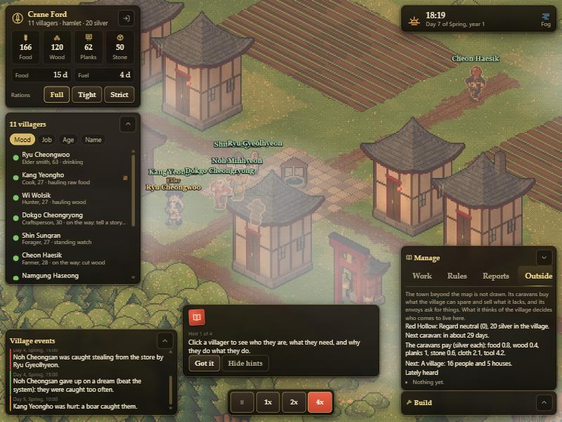

# M5: the Outside and polish

Milestone M5 of `docs/ROADMAP.md`, built on the branch `m5-the-outside` (stacked on `m4-orders-rules-reports`), written in the owner's main
session. Design inputs: `docs/GAME_DESIGN.md` ("The village and the world", "Growth", "Decide events").

Done when: the town beyond the map trades, sends envoys, takes and sends people and gives news; a settlement grows from hamlet to village to town
and the growth matters; a new player is shown what to try; and the whole game is playable end to end. All of it is in the sim, the host and the
client, and measured in the soak.

## What you get

### The Outside (`sim/outside.ts`, `shared/data/policy.ts`, `BAL.outside`)

The town beyond the map is not drawn. It is a small state (`st.outside`): a name, how well it does (wealth, drifting between 20 and 90), what it
thinks of the village (**regard**, -100 to 100, fading to nothing by 0.05 a day), a trade pact flag, the day of the next caravan, and recent news.
The village has **silver** (it starts with 20), which only the Outside gives and takes. It is shown on the village card and in the Outside tab.

- **Caravans** (the first around day 25, then about every 28 days, 20 with a trade pact). A caravan puts a decision to the manager: *sell and buy*,
  *only sell* or *send them on*. It buys the village's **surplus** (half of what is beyond 18 days of food, beyond a winter of wood plus a reserve,
  beyond 150 stone and 100 planks) at 70% of the day's price, and sells what is wanted (planks, tools, cloth, stone up to the stock goals) at 130%, spending
  the proceeds and the treasury and keeping 5 silver. Prices are the base price (food 1.2, wood 0.5, planks 1.4, stone 0.9, cloth 3, tool 6) times the
  town's wealth, its regard and any price shock a rumour has caused. Unanswered after 3 days, or at once while the manager is away, the village does
  *sell and buy* when there is something to gain and sends them on otherwise. Each trade raises regard by 2.
- **Envoys** (from day 60, at least 70 days apart). The Warden's envoy either **asks for tribute** (8 silver plus 1.2 a person plus 4 a year; the
  village pays it from its silver and, short of that, from its food and wood at half price) or, when the town likes the village, **proposes a trade
  pact** for 10 food. To tribute the manager can *pay* (regard +8), *bargain* (even odds of paying half and regard +3, otherwise it counts as a refusal)
  or *refuse* (regard -15, and one more raider in the next raid). The fallback pays if it can and refuses if not; the pact is taken if there are 10
  days of food.
- **Rumours** (about one in 14 days, and one more with everyone who comes home from the Outside): a famine or a bumper harvest (food price x1.8 or
  x0.6 for 30 days), scarce timber, a new smithy, bandits growing bolder (one more raider in the next raid), sickness that keeps caravans away for 12
  days, a levy that brings an envoy sooner, or praise for the village's honest dealing. They show in the feed and the Outside tab.
- **Travellers.** People who went to see the Outside bring news home and, four times in ten, goods (3 to 8 cloth or 1 or 2 tools).
- **Newcomers** come from the Outside a few each season: more when the village is fed and liked (regard 25 or more adds one, a village or a town
  with plenty of food adds one), fewer when it is disliked (regard -25 or less takes one away), none with under 8 days of food. The pool
  of newcomers is topped up by two a year to at most eight.
- **Emigrants.** At each season's end, when the average mood is under 52, the one or two least loyal people go to the Outside for good.
- **Refugees** (M3) are decisions of the manager since M4.

### Settlement tiers (`TIER_UNLOCK`, `BAL.tiers`)

A settlement is a **hamlet** at the start, a **village** with 16 people and 5 houses, and a **town** with 36 people, 10 houses and a watch post. It
only grows: a village that shrinks stays a village. The feed says when it grows. The tier decides:

| | hamlet | village | town |
|---|---|---|---|
| may build | house, field, well, shrine, watch post, wall | and a second storehouse and a workshop | all |
| rules a manager can keep | 12 | 12 | 12 (the suggested rules need all twelve, so this is not gated; the field is there to tune) |
| orders in hand at once | 8 | 14 | 24 |
| better arrivals | | a fed village gets one newcomer more | |

The build menu greys out what is not yet allowed (with what is needed), the sim refuses it with the same reason, and a rule that wants a locked
building simply waits. The village card shows the tier and the silver.

### The end

A village with nobody left stops itself (manager present or not) and says how long it lasted and the most people it had. That is the score of the
first version: years and days survived, peak people (`st.peak`), tier reached.

### Polish

- **First-run hints** (`ui/hud/hints.ts`): one small card at a time (look at a villager, order a house, open Manage and add the suggested rules, you may
  close the game), ticked off by what the player does, dismissable, and stored only in the browser.
- **Accessibility:** the manager's desk opens with **M**; the decision card is an `alertdialog`; priorities, rules and tabs are real buttons with
  `aria-pressed`, labels and focus; `prefers-reduced-motion` stops HUD animation.
- The in-page mock and the real server carry the Outside the same way (`outside` in the view and in updates, protocol **version 5**); the save is
  snapshot **version 6**, and a version 5 save loads with a fresh Outside whose first caravan is a few weeks from the day it loads.

## Where a rule puts a building (`shared/data/placement.ts`)

A building rule used to take the nearest free spot to the green, which put a field in the middle of the square. It now scores every valid spot by kind
(lower is better; the best place first, and if the builders could not reach it from the green the next is tried):

| kind | wants |
|---|---|
| field | at least 9 tiles from the green, about 13 out, next to the other fields (so they share a way in), off the Blight |
| house | about 8 tiles from the green, close to other houses, not within 5 tiles of a field |
| well | among the houses, at least 10 tiles from the map's own well and any other well |
| storehouse | about 7 tiles from the green, near the houses and fields it serves, away from another storehouse |
| workshop | about 10 tiles out, near a storehouse, not hard against the houses |
| shrine | about 12 tiles out, away from other shrines |
| watch post | about 17 tiles out, towards the road the raiders come along, at least 10 tiles from another post |
| wall | about 15 tiles out across the road (north to south when it runs east to west), end to end with the last segment with one tile between (a way through) |

Everything keeps a tile of room around it so doors and paths stay clear, and nothing but the first plaza stands within 5 tiles of the green. The scripted
manager of the soak and the rules use the same function. Clicking a spot yourself is unchanged. A rule soak after the change: 100% survive five years,
27.6 people on average (it was 33.6 before; the spread between seeds is as large as the difference).

## What differs from the spec, and what is not done

- **The Outside is a state, not a place.** There is no map marker (the design left that open) and no walking caravan on the map; caravans and envoys are
  decisions in the feed and in the Outside tab. Villagers who go to see the Outside walk to the edge and vanish, as before.
- **One town.** "Later more": the state is one `OutsideState`; several would be a list of them.
- **Trade is decided per caravan, not by rule.** There is no rule action that answers a decision; the village's fallback is that rule. The manager cannot
  buy or sell outside a caravan's visit.
- **No new buildings.** The tiers unlock the existing eight kinds. New art (a market, a gate, a barracks) is the largest piece of polish left.
- **The tier does not change the look of the village**, and does not change the map. The build radius is the same.
- **Art, sound and balance polish are not done.** No new sprites were made; there is no sound (not in the first version).
- **A rule cannot condition on silver or regard** (only on what the village itself holds); it could be added as two metrics.
- **Raiders are still not drawn** (M3).

## Tests

- `m5.test.ts` (21): prices follow wealth, regard and rumours; a deal sells only a surplus and buys only what is wanted and affordable; caravans come
  on their day with a decision and set the next; selling and buying, selling only, and sending on; unanswered and away fallbacks; no caravans for a
  town that thinks badly of the village; envoys (paying, refusing and the raid bonus, the fallback by what the village can pay, a pact); rumours' effects
  and that they are kept to five; people coming home with news and goods; newcomers by regard and food and the yearly pool; emigrants at a season's end;
  tiers rising and never falling, what each allows, the cap on orders and that the suggested rules fit a hamlet; the view; the save (a version 5 save loads, a round trip, and a run
  that continues exactly after a save and load with a caravan decision waiting).
- Updated: `construct.test.ts`, `m3.test.ts`, `m4.test.ts` and the test kit (a town by default) for tier gating and the new snapshot version; the golden
  run's facts moved a little and its digest changed (`3c25244e:38511` to `957d8526:39279`) because the Outside draws from the village's random stream
  every day; `session.test.ts` for the new view fields.

## Measurements

**With the scripted manager placing orders.**

| seed | people at the end of years 1 to 5 | tier at the end | peak | caravans | silver earned / spent | tribute paid / refused | refugees taken |
|---|---|---|---|---|---|---|---|
| 1 | 19, 26, 31, 40, 44 | town | 44 | 17 | 2064 / 795 | 46 / 1 | 11 |
| 2 | 17, 25, 26, 31, 41 | town | 41 | 16 | 1659 / 499 | 128 / 0 | 9 |
| 3 | 23, 34, 39, 45, 53 | village | 53 | 15 | 1682 / 342 | 145 / 1 | 12 |
| 4 | 14, 18, 25, 34, 36 | village | 36 | 14 | 723 / 404 | 65 / 4 | 9 |
| 5 | 16, 20, 24, 26, 24 | village | 28 | 17 | 1592 / 340 | 94 / 1 | 0 |
| 6 | 17, 26, 29, 34, 43 | town | 43 | 11 | 1348 / 125 | 51 / 2 | 8 |
| 7 | 18, 24, 29, 33, 38 | town | 38 | 16 | 1091 / 720 | 50 / 0 | 10 |
| 8 | 12, 15, 19, 27, 35 | village | 35 | 8 | 69 / 84 | 0 / 6 | 14 |

survival (population of at least 6 at the end of the year): year 1 100% (8/8), year 3 100% (8/8), year 5 100% (8/8).  
population at the end, survivors: 44, 41, 53, 36, 24, 43, 38, 35 (average 39.3).

**On the suggested rules alone (`--rules`).**

| seed | people at the end of years 1 to 5 | tier at the end | peak | caravans | silver earned / spent | tribute paid / refused | refugees taken |
|---|---|---|---|---|---|---|---|
| 1 | 11, 19, 18, 21, 22 | village | 23 | 8 | 242 / 256 | 0 / 5 | 5 |
| 2 | 10, 8, 12, 14, 19 | village | 20 | 18 | 1086 / 503 | 73 / 1 | 5 |
| 3 | 14, 22, 28, 27, 37 | village | 37 | 7 | 192 / 206 | 0 / 6 | 3 |
| 4 | 16, 24, 28, 35, 41 | village | 41 | 12 | 1290 / 308 | 136 / 0 | 4 |
| 5 | 13, 21, 23, 31, 40 | village | 40 | 12 | 613 / 145 | 0 / 0 | 8 |
| 6 | 16, 26, 33, 34, 39 | village | 40 | 9 | 666 / 45 | 118 / 2 | 10 |
| 7 | 17, 26, 30, 34, 40 | village | 41 | 10 | 427 / 296 | 29 / 2 | 4 |
| 8 | 21, 25, 28, 28, 31 | village | 31 | 11 | 635 / 184 | 45 / 1 | 4 |

survival (population of at least 6 at the end of the year): year 1 100% (8/8), year 3 100% (8/8), year 5 100% (8/8).  
population at the end, survivors: 22, 19, 37, 41, 40, 39, 40, 31 (average 33.6).

**With no manager (`--no-manager`).**

| seed | people at the end of years 1 to 5 | tier at the end | peak | caravans | silver earned / spent | tribute paid / refused | refugees taken |
|---|---|---|---|---|---|---|---|
| 1 | 17, 25, 32, 35, 43 | village | 44 | 12 | 1092 / 302 | 202 / 2 | 11 |
| 2 | 20, 20, 15, 16, 11 | village | 21 | 3 | 96 / 111 | 0 / 5 | 9 |
| 3 | 11, 12, 13, 9, 10 | hamlet | 15 | 14 | 660 / 628 | 0 / 0 | 3 |
| 4 | 11, 15, 12, 10, 10 | village | 17 | 7 | 330 / 342 | 0 / 3 | 9 |
| 5 | 11, 11, 12, 14, 8 | village | 18 | 14 | 628 / 559 | 81 / 2 | 12 |
| 6 | 20, 20, 15, 9, 8 | village | 22 | 7 | 111 / 125 | 0 / 4 | 11 |
| 7 | 12, 10, 13, 7, 8 | village | 17 | 15 | 734 / 548 | 26 / 2 | 9 |
| 8 | 16, 11, 15, 10, 8 | village | 19 | 9 | 234 / 247 | 0 / 4 | 8 |

survival (population of at least 6 at the end of the year): year 1 100% (8/8), year 3 100% (8/8), year 5 100% (8/8).  
population at the end, survivors: 43, 11, 10, 10, 8, 8, 8, 8 (average 13.3).

How to read them:

- **The Outside makes the village grow.** With a manager the villages end at 24 to 53 people (average 39), inside the 20 to 40 band the balance sheet gives for
  survivors, and every one survives five years. Caravans bought 69 to 2064 silver's worth of surplus per run (most over 1000) and sold 84 to 795 silver's worth of what was wanted; newcomers
  came more often to a village the town liked; refugees were taken in 0 to 14 times.
- **A village on the suggested rules alone does almost as well** (average 34, all eight survive), as it did in M4.
- **A village with no manager survives but stays small** (average 13, one of eight reaching 43): its raids still overrun it, but the caravans and the refugees
  keep it from collapsing, because the village's fallbacks sell the surplus and take refugees in.
- **The tier follows the growth:** most managed villages become a village in year 1 or 2 and half become towns (36 people, 10 houses, a watch post); the
  unmanaged ones stay hamlets or small villages.
- **Silver piles up** (500 to 1250 in many runs): there are few uses for it (caravan purchases and tribute). More to spend it on (a market, mercenaries, a
  tutor, a gate) is the obvious next piece of content.
- No emigrants in 24 runs: leaving needs an average mood under 52 at a season's end and some people with little loyalty, and the villages were not that unhappy.
- Measured on this computer; the bench is as before (the Outside adds a few hundredths of a millisecond per day).

## How to try it

- In the page mock (`npm run dev:client`, `http://localhost:5173/?mock=1&seed=3`): the card shows "hamlet" and the silver; **Manage**, tab **Outside**,
  shows the town, its regard, the next caravan, what the caravans pay and what was heard. Press `3` for 4x: the first caravan comes around day 25 (a
  few real minutes) and asks for a decision in the middle of the screen.
- `npm run soak -- --years 5 --seeds 1,2,3,4,5,6,7,8` prints the Outside's line (tier, peak, caravans, tribute, emigrants, refugees) per seed.
